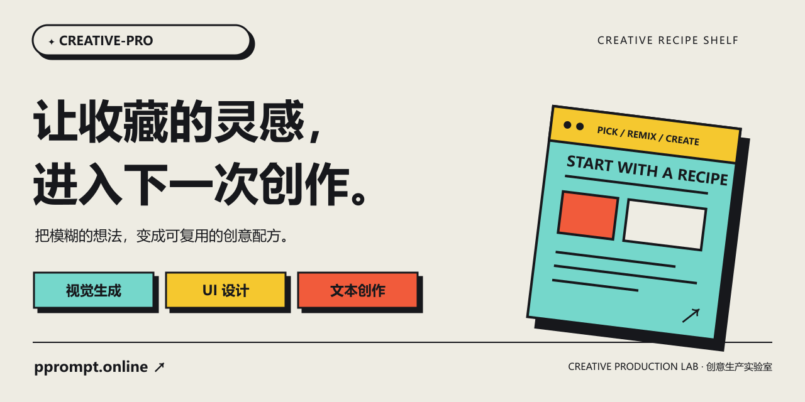
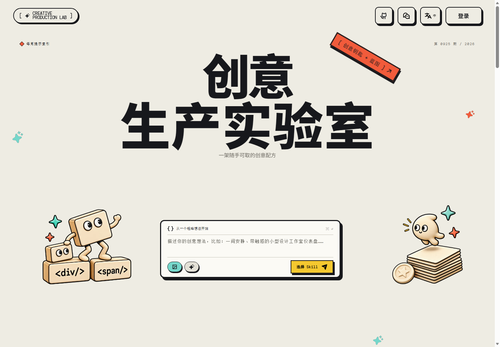
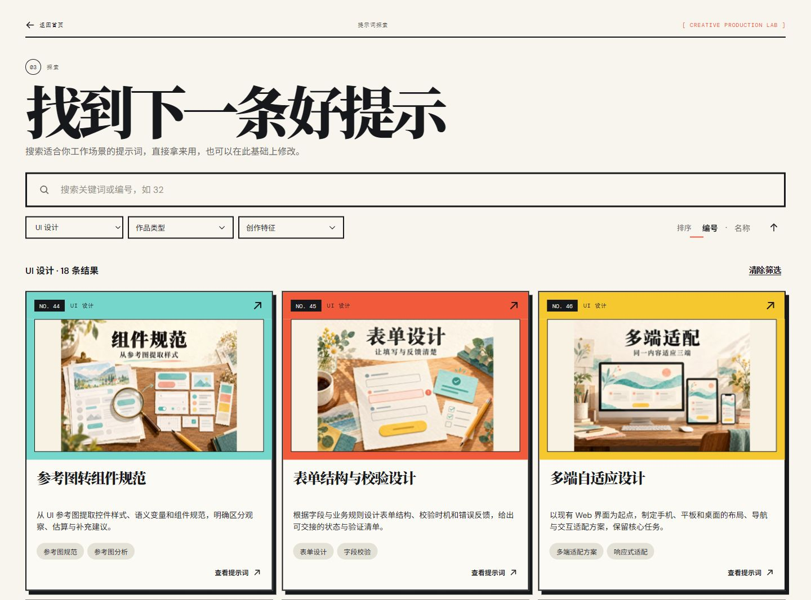
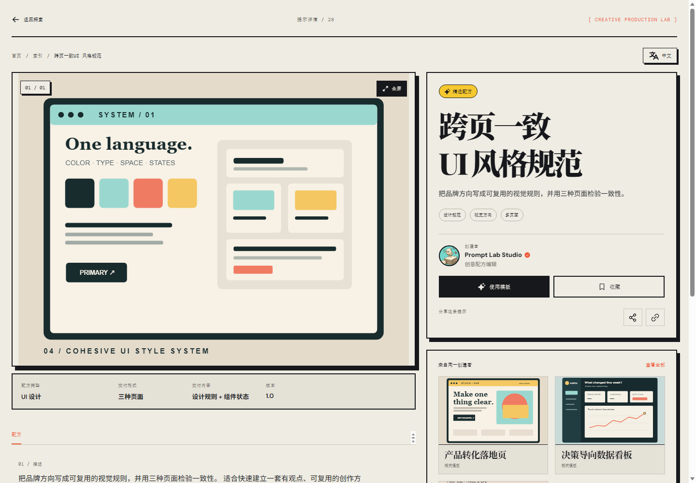
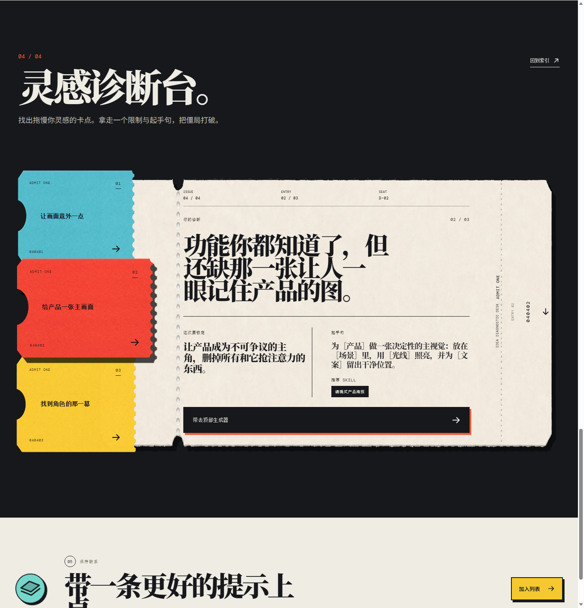
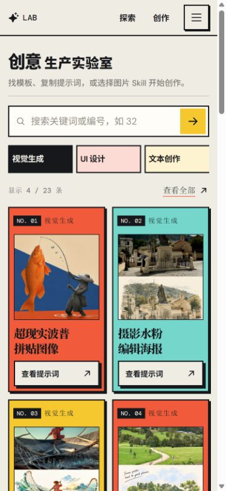
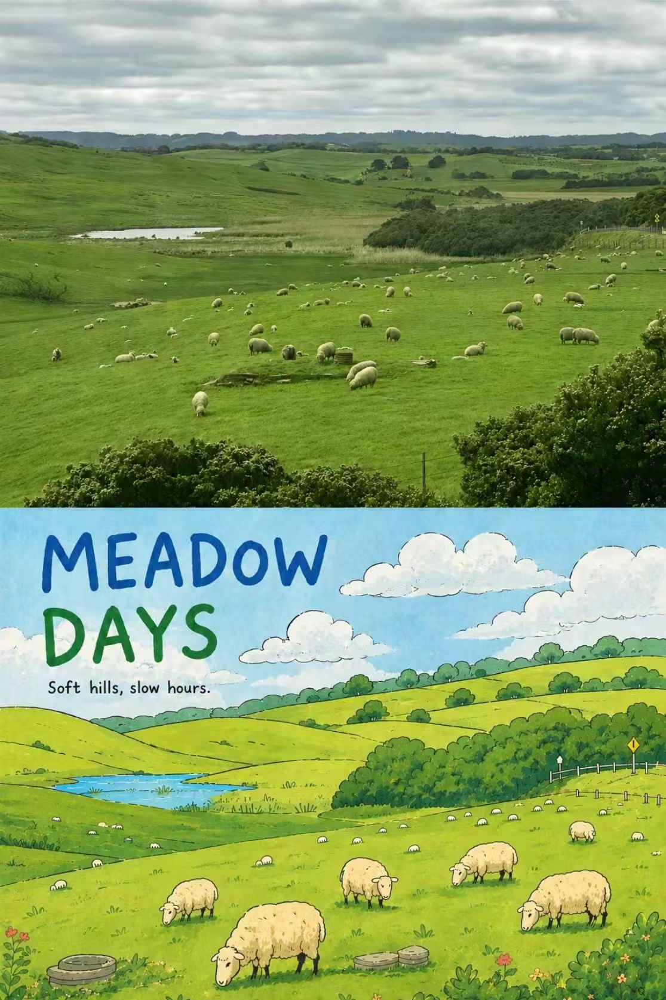
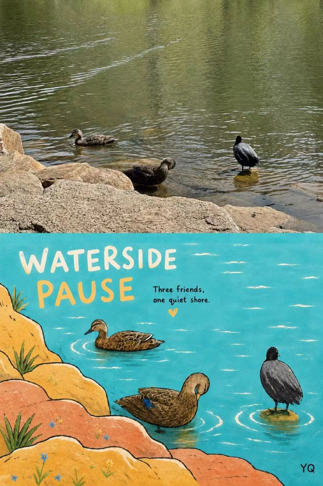
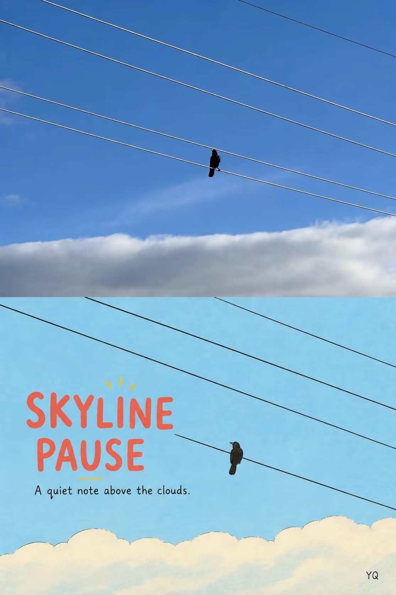

  

# Creative-Pro · 创意生产实验室

**先看见方向，再把方法带进自己的作品。**

给设计、写作和视觉创作准备的一架创意配方书架。把作品预览、完整提示词放在一起，附上使用步骤和约束，让下一次创作有一个具体的起点。

**[打开网站 ↗](https://pprompt.online/) · [探索配方](https://pprompt.online/explore/) · [English](README.en.md)**

## 从“这个不错”到“我知道怎么开始”

收藏了一张海报、一种界面和一段好表达，真正动手时，需要的是一个能接着做的方向。

在 Creative Production Lab，你可以先看预览，再按任务找到配方；看清输入、步骤和边界后，把适合自己的方法带走。

| 你的任务 | 可以带走什么 |
| --- | --- |
| 给照片一个新的表达 | 摄影与手绘、拼贴、海报和调色的创作方向 |
| 把页面做得更有章法 | 整页设计方向、组件规范、表单校验、排版与微交互的提示词 |
| 让文字服务具体任务 | 文章、口播、小说与短剧的写作、修改和检查方法 |

## 01 · 一个统一的创作起点

纸张、粗墨线与错位阴影，加上两侧吉祥物，组成一张有辨识度的创作桌。

首页把图片 Skill、这次的想法和参考图放在同一个入口。选择模板后，缩略图和名称保留在工具栏里，让你清楚接下来要使用哪一套方法。

**[打开创作桌 ↗](https://pprompt.online/#create)**

## 02 · 按任务找配方

视觉生成、UI 设计和文本创作共用一个探索入口。关键词和编号搜索，配合作品类型、创作特征与排序，帮助你从“想做什么”找到“可以怎么做”。

**[探索全部配方 ↗](https://pprompt.online/explore/)**

## 03 · 看清方法，再开始

详情把预览、提示词放在一起，同时列出排除项和使用说明。具备完整执行说明的 Skill，还能查看流程、质量门与复用方法。

“使用模板”附近会说明下一步：复制到自己的 AI 工具，或把图片 Skill 带回创作桌。

**[查看这个配方 ↗](https://pprompt.online/prompt/surreal-pop-collage/)**

## 04 · 卡在起步时，拿走一个具体方向

灵感诊断台用三种创作意图组织起手方法：选一个卡点，得到可用的限制和可编辑的起手句，再带回首页继续写。

票根与主票相连，选择状态、诊断内容和主操作有清楚的层级。

**[试试灵感诊断 ↗](https://pprompt.online/#diagnostic)**

## 05 · 手机上的下一步也清楚

手机把搜索、分类和精选配方放在前面；筛选可以收起，已选条件仍然可见。详情页先展示标题和主操作，长提示词留在后面。

  

选择、复制和筛选都有短暂反馈，画廊切换也是如此；键盘操作、可见焦点与“减少动态效果”偏好也被纳入交互设计。

> 界面截图来自 2026-10-12 的本地待发布版本，展示真实页面状态。线上页面可能尚未同步全部更新。

## 从一张照片开始 · 手绘旅行海报

上半留住照片的现场，下半用手绘重述同一段记忆。羊群、水边的小鸟和天空中的电线，都可以成为海报的叙事起点。

| 草地羊群 · Meadow Days | 水边小鸟 · Waterside Pause | 天空电线 · Skyline Pause |
| --- | --- | --- |
|  |  |  |

**[打开照片手绘旅行海报 ↗](https://pprompt.online/prompt/photo-handdrawn-travel-poster/)**

这些是网站模板画廊中的现有示例，可点击查看大图；不是本次新执行的生成任务，也不保证重复得到相同结果。

## 现在可以怎样使用

- **UI 与文本配方：**查看完整内容，复制到适合的 AI 工具中使用。
- **视觉配方：**浏览预览、提示词与方法，带上自己的素材继续创作。
- **站内图片生成：**前端已有入口；当前线上生成提交与 Full Skill 开关尚未开放。这个展示仓库不代表生成服务已经启用。

## 一起把配方做得更好

欢迎在 [Issues](https://github.com/AurvalLab/Creative-Pro/issues) 留下具体反馈：你带着什么任务来、尝试了哪套配方、在哪一步卡住，以及希望得到什么结果。

如果这里有你想留到下次使用的方法，可以给仓库一个 Star。

由 [AurvalLab](https://github.com/AurvalLab) 制作。本仓库收录项目介绍、界面截图，也收录示例作品和[宣传文案](docs/launch-copy.md)。应用源码、运行配置和账户数据不在其中。

素材来源与使用范围见[说明](docs/assets-and-sources.md)。公开展示不授予应用源码、模板库或第三方素材的开源许可。
